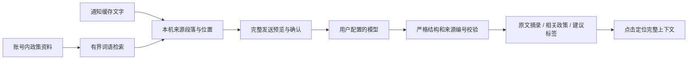

# AI 摘要与政策资料

第 8 版采用“AI 选择原文、App 展示依据”的方式。它适合快速找到事项、对象、行动、时间、地点、材料和条件；模型不直接改写这些事实。引用存在只证明文字来自提供的资料，仍可能归类错误或遗漏例外，不能替代通知全文或主管部门确认。

## 配置服务

1. 打开侧栏的 AI 服务设置，点击 DeepSeek 预设。使用自己的服务 API Key，按需修改模型名，保存并启用手动摘要。
2. 当前预设为 `https://api.deepseek.com/chat/completions`、`deepseek-flash`。模型名称可编辑，适配器显式关闭思考模式并要求 JSON 输出。选择预设、保存设置、打开通知均不会自动调用模型。
3. 其他服务选择自定义兼容接口，填写完整 HTTPS `…/chat/completions` 地址和模型 ID，要求支持 JSON 对象输出。自定义模式不附加 DeepSeek 专用参数；不代表兼容所有厂商协议。
4. 更换地址必须重新提供对应密钥，不能把旧服务的密钥默默发送到新地址。密钥通过 AndroidKeyStore 加密保存，不随校园配置分享。

从旧版升级至 0.8.1 时，没有服务类型字段且地址严格匹配官方 DeepSeek 的配置会自动采用非思考适配器，不需要重填密钥；已显式选择自定义类型或填写代理地址的配置不会被改动。第 6 版的 1,000-token 上限可能被默认思考过程耗尽，出现 HTTP 200 但最终内容为空。新版本区分输出上限、空结果和格式错误，不能把服务接收请求理解成摘要已经生成。

生成时请保持摘要页前台；离开或锁屏会取消本机请求，服务方仍可能计费。返回时会说明该次取消，已有缓存保留，不自动补发。

DeepSeek 适配依据官方 [Chat Completions](https://api-docs.deepseek.com/api/create-chat-completion/)、[JSON 输出](https://api-docs.deepseek.com/guides/json_mode/)和[思考模式](https://api-docs.deepseek.com/guides/thinking_mode/)文档（核对日期：2026-11-03）。空白输出、非完成响应、错误结构或超限响应会失败，不进行自动重试。服务可改变模型可用性、价格与数据政策，应用不内置免费额度或余额查询。

## 添加自己的政策

侧栏“政策资料库”使用系统文件选择器导入 UTF-8 TXT 或可提取文字的 PDF，随后填写标题、发布单位、版本/文号、生效与失效日期、适用对象/校区/范围、效力状态和来源说明。未知可留空，状态默认待核验；所有元数据都是用户填写，不表示应用核验过官方来源。

每个账号最多 20 份，每份最多 8 MiB、40 页、100,000 字符，总文字最多 1,000,000 字符。超限拒绝导入，不静默截取。只保留提取文字、页序和填写信息，不保留原 PDF。请保留原件核对排版、图片、表格和脚注；扫描件、加密 PDF、DOCX、图片 OCR 和附件解析暂不支持。混合 PDF 的无文字页会保留页位置，但不能说明该页没有内容。

PDF 导入面向用户信任的文字文件。文件、页数、文字和临时存储有上限，并设置协作式超时/取消检查；这些不构成解析器总内存或 CPU 的硬限制。底层文件提供器或解析器内部操作可能不立即响应取消，本版没有独立进程的强制终止沙箱。

更换文件请导入新版本并自行标明旧版状态，或删除旧版。添加、编辑和删除均清理当前账号的所有摘要缓存，并停止旧请求回写；通知、阅读状态和手动标签保留。删除本机资料不能撤回先前已确认发送给服务方的内容。

## 一次摘要的过程

政策检索在本机按中文双字词、字母词及词语权重选取，最多 8 个片段、6,000 字符，优先带入邻接段落。通知最多 160 个来源单元、整库政策最多 6,000 个检索单元，过度碎片化的资料会提示整理后重试。它不是语义向量检索，同义表达和短文本可能漏检；“未找到”仅表示本次有限检索没有选中，不说明没有相关政策。检索不自动认定较新版本具有更高效力，也不推断文件间替代关系。

预览包括本次通知文字、选入的政策片段及元数据、候选标签，确认后才发送。通知原文地址不作为单独字段发送，但正文或用户填写的来源说明本身可能包含地址、姓名等信息，需要在预览中核对。校园 Cookie、门户密码、动态码和校园认证令牌不加入请求；AI 服务的 API Key 仅用于该服务认证。

模型只能返回来源单元编号，不得生成新的日期、资格或链接。App 从同一次不可变资料快照取回文字，点击依据按真实页码、段落与偏移高亮；重复出现的文字也能定位到选中的那一处。来源错误的选项被丢弃，丢弃数量保存在摘要缓存中。空字段显示“未找到可核实摘录”，不补猜。

政策关联一律标为“相关参考、适用性待核对”。即使引文正确，也不能据此认定自己具备资格、文件仍有效或不存在冲突。标签建议来自 7 个内置分类与现有手动标签，需点击“采纳标签”才会追加，不覆盖其他标签、不自动修改提醒规则。

正文最多 12,000 字符，结构化用户消息最多 22,000 字符，请求负载最多 128 KiB；摘要结果最大 16 KiB、HTTP 响应最大 64 KiB，输出上限 2,000 tokens。每天每账号最多 20 次本机尝试，单请求总超时 40 秒。超时、取消、拒绝结果也可能被服务计费；应用不自动重试或后台生成。清除摘要或改变服务配置会使旧请求失效。

## 怎样判断模型质量

代码回归验证的是结构、来源、隔离和状态保留，不能证明真实模型提取优秀。仓库提供 12 个合成的中文通知评测样例，涵盖否定、跨段例外、多日期、仅发布日期、活动取消、相对时间、金额前提、缺失附件、提示注入、更正和政策适用性未知。样例不含真实校园材料。

- 样例：`app/src/test/resources/ai-eval-cases.jsonl`。`N1` 为标题，后续编号对应本组样例的非空正文行；生产来源由 `AiEvidence` 生成。
- 对模型回复做人工核对后，记录每行 `{"id":"volunteer","output":{...schema 2 原始输出...}}`，覆盖所有样例。
- 运行 `python scripts/score_ai_eval.py --predictions outputs.jsonl`，查看来源选择精度、必要依据召回、标签精度/召回、错误非空字段和关键禁止选项。无政策文件的这组样例不评估政策检索。
- `python scripts/score_ai_eval.py --self-test` 只检查计分器，既不调用模型，也不是模型得分。自动回归明确包含“来源有效但分类错误、漏掉邻段例外仍会通过来源校验”的反例。

这些样例规模小，不能泛化为生产准确率。正式选模型前，应另用未参与调试的通知及政策样本，人工标出必要事实、完整条件、适用范围和依据；分别测检索召回、引用正确性、事实/条件覆盖、分类和拒答，比较成本与时延。不得把格式通过率、服务商自己的分数或合成完美答案当成真实模型效果。0.8.1 已做真实 DeepSeek 请求与单条通知的手机显示、引用和缓存验证，尚未做语义质量基准测试。
