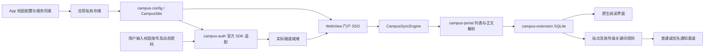

# 架构与数据流

`campus-config` 提供纯 Java 的运行时配置校验。`CampusSite` 默认为空，完整配置验证通过后才安装不可变快照；认证域、VPN 地址、通知列表和登录入口共同生成稳定的站点范围标识。测试自行安装合成配置，构建不读取实际校园地址。

`CampusConfiguration` 将用户填写的服务参数与连接服务同意状态保存在应用私有存储。首次保存不启动 SDK，可继续进入认证页面；显式连接或恢复已授权会话才初始化 SDK。`ConsentStorageProvider` 阻止厂商 Provider 提前处理设备信息。修改配置先标记过渡状态、停止连接并清除 Cookie、网页存储及客户端证书选择；一旦尝试过原生 SDK 初始化，本进程不再安装另一组参数，保存后关闭应用并在下次启动加载。

认证服务使用显式填写的 HTTPS 地址，可位于受信任服务提供商的域名。门户主机必须属于校园认证域；认证网页只允许校园域内 HTTPS，HTTP 仅限门户主机。统一网址校验拒绝非法协议、主机、端口及内嵌凭据。静态网络安全配置允许兼容旧门户所需的明文请求，实际 HTTP 范围由应用请求及 WebView 校验限制。

`CampusAuthController` 分别处理认证结果和隧道状态。只在实际访问就绪后请求校园内容；门户 Cookie 的归属单独管理，切换账号时清理旧门户会话。配置变更会立即撤销当前账号就绪状态，旧 SDK 回调不会重新激活它。`ReaderHttp` 和媒体传输捕获站点与账号的读取范围，在请求和写入 Cookie 前后重新检查，阻止旧请求继续污染新会话。认证适配依赖 Sangfor SDK 和目标服务策略，不是通用 VPN 实现。

`CampusSyncEngine` 在工作线程中执行单页同步，复用刷新锁、取消及账号检查。`CampusPortalParser` 识别门户稳定 `wbnewsid`，分类树变化不会让同一通知成为新文章；列表和详情的编号必须一致。解析器只支持已适配的门户页面结构，修改站点地址不保证兼容其他门户。没有稳定编号的其他来源可使用规范化原文 URL 的来源内身份策略。

`CampusNoticeStore` 使用来源加稳定编号作为复合身份。数据库、媒体缓存和规则的账号范围由 `SHA-256(站点范围 + NUL + 账号)` 生成，同名账号在不同配置下不会共用缓存；未配置或未选择账号时使用本地范围。正文与轻量元数据分离，已读、稍后读、标签分别维护。容量与年龄策略可清正文，保留轻量历史以防重复提醒和阅读状态丢失。

`KeywordRules` 按站点配置及本地账号命名空间保存规则，`NoticeQuery` 在分页之前应用标题/缓存正文匹配。任一屏蔽词排除通知，任一优先词选入重点关注；临时搜索、包含/排除词、标签及未读条件可叠加。

后台通知使用本次真正插入的身份集合重新查询当前未读和关键词状态。屏蔽项不计入通知，优先项进入单独的 HIGH 渠道；保存规则与发布提醒共享锁，防止旧规则在保存后继续发出通知。系统权限和渠道设置决定最终呈现，不承诺实时推送。

Java 包名前缀统一为 `org.campusreader`。界面采用标准 Android 控件及项目自有资源，各模块通过明确的数据和认证边界协作。
