# 架构与数据流

```mermaid
flowchart LR
  Config[App 校园配置与服务同意] --> Private[应用私有存储]
  Private --> Site[campus-config / CampusSite]
  Site --> Auth
  Site --> Portal
  User[用户输入校园账号及动态密码] --> Auth[campus-auth 官方 SDK 适配]
  Auth --> Tunnel[实际隧道就绪]
  Tunnel --> Portal[WebView 门户 SSO]
  Portal --> Sync[CampusSyncEngine]
  Sync --> Parser[campus-portal 列表与正文解析]
  Parser --> Store[campus-extension SQLite]
  Store --> Reader[原生阅读界面]
  Store --> Rules[站点及账号级关键词规则]
  Rules --> Notifications[普通或优先通知渠道]
  Sync --> History[有界刷新与提醒记录]
  Notifications --> History
  Reader --> Confirm[用户核对并确认发送文字]
  Confirm --> AI[独立 AI HTTPS 客户端]
  AI --> Check[结构与原文引文校验]
  Check --> Summary[站点及账号内的摘要缓存]
  Summary --> Reader
```

`campus-config` 提供纯 Java 的运行时配置校验。`CampusSite` 默认为空，完整配置验证通过后才安装不可变快照；认证域、VPN 地址、通知列表和登录入口共同生成稳定的站点范围标识。测试自行安装合成配置，构建不读取实际校园地址。

`CampusConfiguration` 将用户填写的服务参数与连接服务同意状态保存在应用私有存储。首次保存不启动 SDK，可继续进入认证页面；显式连接或恢复已授权会话才初始化 SDK。`ConsentStorageProvider` 阻止厂商 Provider 提前处理设备信息。修改配置先标记过渡状态、停止连接并清除 Cookie、网页存储及客户端证书选择；一旦尝试过原生 SDK 初始化，本进程不再安装另一组参数，保存后关闭应用并在下次启动加载。

`CampusConfigImport` 是无 Android、无网络副作用的解析器，限定 16 KiB UTF-8 平面 JSON 与 version 1 白名单字段，拒绝重复/未知字段，并复用 `CampusSite.create()` 验证地址。`CampusConfigActivity` 先显示当前草稿与导入值的差异，用户确认后只填入表单并取消服务同意勾选，沿用原有保存与重启流程。解析失败、取消或仅预览均不会安装配置快照。

第 7 版增加独立的 `SchoolDirectory` 数据目录：最多 100 所学校、256 KiB，拒绝未知或重复字段，沿用站点地址验证。`SchoolDirectoryStore` 在不参与备份的应用私有目录原子保存目录；导入文件或下载用户指定的 HTTPS 目录后，可离线搜索和选择学校。目录不包含账号、脚本或服务同意；选择学校只填写配置草稿，相同配置保存不清理现有会话。公开安装包不包含具体学校目录或默认目录服务。

认证服务使用显式填写的 HTTPS 地址，可位于受信任服务提供商的域名。门户主机必须属于校园认证域；认证网页只允许校园域内 HTTPS，HTTP 仅限门户主机。统一网址校验拒绝非法协议、主机、端口及内嵌凭据。静态网络安全配置允许兼容旧门户所需的明文请求，实际 HTTP 范围由应用请求及 WebView 校验限制。

`CampusAuthController` 分别处理认证结果和隧道状态。只在实际访问就绪后请求校园内容；门户 Cookie 的归属单独管理，切换账号时清理旧门户会话。配置变更会立即撤销当前账号就绪状态，旧 SDK 回调不会重新激活它。`ReaderHttp` 和媒体传输捕获站点与账号的读取范围，在请求和写入 Cookie 前后重新检查，阻止旧请求继续污染新会话。认证适配依赖 Sangfor SDK 和目标服务策略，不是通用 VPN 实现。

`PortalLoginActivity` 先利用 WebView 中已有的统一认证会话，再由 `PortalSessionCoordinator` 限制每次前台恢复的提交次数、超时与重试间隔。只有精确匹配 `PortalLoginPolicy` 的 HTTPS 认证页面和表单目标可使用保存的密码；未识别页面回到手动登录。原生密码表单明确显示保存选项，成功获取并解析当前门户通知列表后才写入 `PortalCredentialStore`。凭据由 AndroidKeyStore AES-GCM 加密，并绑定站点、账号和认证目标；设置页可离线删除。自动恢复不保存校园动态码、不定时提交密码、不在后台执行，失败时保留缓存和阅读状态。

门户验证和媒体请求将取消条件带到实际执行的主线程 Cookie 写入，账号变化或失效请求不能继续排队写入。媒体分享 URI 包含每次缓存写入产生的随机版本；Provider 在同一锁内验证版本并打开文件，缓存替换后旧链接无法打开新内容。已授予并已打开的文件描述符无法由应用收回。

重新获取正文与分页刷新共用 `SyncGate`，在请求及写库前检查门户代次；列表缩略图也检查门户和前台请求代次。离开阅读页面所属 Activity 或销毁 Activity 会使其前台请求失效，防止旧结果继续回填。同步引擎把取消和会话检查传给 HTTP 层，Cookie 写入遵守相同的请求有效期。

`CampusSyncEngine` 在工作线程中执行单页同步，复用刷新锁、取消及账号检查。`CampusPortalParser` 识别门户稳定 `wbnewsid`，分类树变化不会让同一通知成为新文章；列表和详情的编号必须一致。解析器只支持已适配的门户页面结构，修改站点地址不保证兼容其他门户。没有稳定编号的其他来源可使用规范化原文 URL 的来源内身份策略。

`CampusNoticeStore` 使用来源加稳定编号作为复合身份。数据库、媒体缓存和规则的账号范围由 `SHA-256(站点范围 + NUL + 账号)` 生成，同名账号在不同配置下不会共用缓存；未配置或未选择账号时使用本地范围。正文与轻量元数据分离，已读、稍后读、标签分别维护。容量与年龄策略可清正文，保留轻量历史以防重复提醒和阅读状态丢失。

`KeywordRules` 按站点配置及本地账号命名空间保存规则，`NoticeQuery` 在分页之前应用标题/缓存正文匹配。任一屏蔽词排除通知，任一优先词选入重点关注；临时搜索、包含/排除词、标签及未读条件可叠加。

规则草稿预览只读取本机缓存，显示命中数量、词语和正文是否仍在缓存，每组最多展示最新 30 条。预览内容不会自动标为已读。保存保留上一份规则快照，相同内容的重复保存不消耗撤销机会；撤销只恢复规则，不改阅读状态或重推历史内容。严格加载区分“没有规则”和“规则损坏”，防止提醒流程把损坏配置当成全放行。

后台通知使用本次真正插入的身份集合重新查询当前未读和关键词状态。屏蔽项不计入通知，优先项进入单独的 HIGH 渠道；保存规则与发布提醒共享锁，防止旧规则在保存后继续发出通知。系统权限和渠道设置决定最终呈现，不承诺实时推送。

`NotificationHistory` 保存按账号分隔的最近 200 条、14 天内记录，内容是刷新结果、计数、通知身份哈希、规则版本哈希、首个命中词和固定原因，不复制正文、标题、地址或错误原文。`NotificationDecision` 固定抑制原因的优先次序；渠道关闭时不会把优先提醒降级发送到普通渠道。“已提交系统”只表示本次通知 API 调用成功，不表示用户已看到。前台刷新写诊断结果而不另发后台提醒。`ReaderPreferences` 的最近尝试与最近完整成功时间均按账号保存，部分成功不覆盖完整成功时间。

## 手动 AI 摘要

`AiSettings` 默认关闭，按站点及账号存储服务地址、模型与本机调用计数。API Key 使用 AndroidKeyStore 生成的 AES 密钥、GCM 模式和账号范围关联数据加密，不以明文放在偏好中；不宣称所有设备都提供硬件级密钥保护。设置修订号用于拒绝设置变更后的旧请求。改变服务地址不能默默沿用旧密钥。

`AiSummaryActivity` 只接受当前账号的已有通知。`SummaryInput` 读取缓存标题与纯文字正文，以标题和正文计算内容哈希；请求前展示完整发送文字，超过 12,000 字符则拒绝。用户确认一次才预占当日一次额度并请求，每个账号每天上限 20 次，输出上限 1,000 tokens。不会在后台刷新、打开文章或设置保存时自动生成摘要。

`AiTransport` 使用独立 OkHttp 客户端，不使用校园 `ReaderHttp`、WebView Cookie、HTTP 认证器或自动重定向；禁止自动连接重试，并阻止特定服务状态引发隐式重试。它只调用用户设置的 HTTPS `chat/completions` 地址，附该服务的 Bearer Key 与摘要请求；响应最大 64 KiB，总调用超时 40 秒。取消会取消本机 HTTP 调用，但不能撤回已到服务方的资料或费用。

`AiSummaryModel` 校验固定 JSON 字段与长度，将每个有值字段的引文与实际发送文字逐字比对，不符合的字段不展示为事实。这个检查证明引文存在，不能证明模型对引文的解释正确，也不能识别所有语义幻觉。模型不获得工具调用能力，原文内的命令被当作待分析资料。摘要和原文分开呈现，AI 生成文本不写入正文或关键词匹配字段。

SQLite 版本 3 增加 `notice_summaries` 和摘要代次，迁移保留原有身份、已读、稍后读及标签。每篇最多保留一条 16 KiB 以内摘要，缓存匹配通知稳定身份、内容哈希和服务地址/模型/提示版本哈希；普通刷新时间变化不触发再生成。正文或标题变更、正文回收、通知删除会使摘要失效。写入前在事务内重新检查内容与清理代次，清空摘要后旧响应不能重新填回缓存。AI 设置、摘要请求和诊断记录均不得串到新账号范围。

Java 包名前缀统一为 `org.campusreader`。界面采用标准 Android 控件及项目自有资源，各模块通过明确的数据和认证边界协作。
