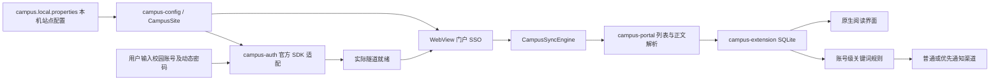

# 架构与数据流

`campus-config` 在构建时读取本机站点配置，生成 `CampusSite` 使用的站点常量。未完成配置时禁止校园登录，并提示配置后重新构建；`-PcampusTestDefaults=true` 强制使用公开示例地址。站点边界用于认证、门户请求和媒体地址校验。

`CampusAuthController` 分别处理认证结果和隧道状态。只在实际访问就绪后请求校园内容；门户 Cookie 的归属单独管理，切换账号时清理旧门户会话。认证适配依赖 Sangfor SDK 和目标服务策略，不是通用 VPN 实现。

`CampusSyncEngine` 在工作线程中执行单页同步，复用刷新锁、取消及账号检查。`CampusPortalParser` 识别门户稳定 `wbnewsid`，分类树变化不会让同一通知成为新文章；列表和详情的编号必须一致。解析器只支持已适配的门户页面结构，修改站点地址不保证兼容其他门户。没有稳定编号的其他来源可使用规范化原文 URL 的来源内身份策略。

`CampusNoticeStore` 使用来源加稳定编号作为复合身份。正文与轻量元数据分离，已读、稍后读、标签分别维护。容量与年龄策略可清正文，保留轻量历史以防重复提醒和阅读状态丢失。

`KeywordRules` 按本地账号命名空间保存规则，`NoticeQuery` 在分页之前应用标题/缓存正文匹配。任一屏蔽词排除通知，任一优先词选入重点关注；临时搜索、包含/排除词、标签及未读条件可叠加。

后台通知使用本次真正插入的身份集合重新查询当前未读和关键词状态。屏蔽项不计入通知，优先项进入单独的 HIGH 渠道；保存规则与发布提醒共享锁，防止旧规则在保存后继续发出通知。系统权限和渠道设置决定最终呈现，不承诺实时推送。

Java 包名前缀统一为 `org.campusreader`。界面采用标准 Android 控件及项目自有资源，各模块通过明确的数据和认证边界协作。
