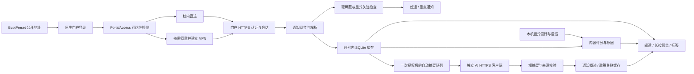

# 架构与数据流

第 9 版为北邮单校产品。公开预设属于产品配置，账号、会话与密钥只由安装后使用产生。

## 身份、通道与会话

`CampusConfiguration.load()` 安装 `BuptPreset`，或保留仍有效的旧北邮配置及其站点范围；不在加载时初始化 SDK。`CampusSite` 和通用配置解析器仍负责网址校验、范围隔离与合成回归，产品不提供其他学校入口。

`PortalAccess` 独立维护门户账号、网络路由、网络代次和检测结果。`DIRECT`、`VPN`、`UNKNOWN`、`UNAVAILABLE` 分别表达实际观察；直连不是伪造 SDK 的 `ACCESS_READY`。匿名探测限定重定向、主机、响应大小和超时，认证页可达不等于通知列表已登录。可达性仅针对已观察网络和有限有效期；切换网络使原结论失效。存在可用校园 Wi-Fi 而默认走移动数据时，校园请求可以单独绑定该 Wi-Fi。

`LoginActivity` 提供原生账号密码首屏，优先复用会话、再走已识别的门户认证；网络不可达才进入 VPN 流程。`CampusAuthController` 继续核实厂商真实认证和隧道状态，SDK 及其设备信息处理仅在需要 VPN 且已同意时开始。动态密码不保存，后台不启动需要用户操作的认证。

`PortalLoginActivity` 只向 `PortalLoginPolicy` 认可的 HTTPS 表单提交密码，验证码、未知页面和错误退回人工。`PortalSessionCoordinator` 限制前台恢复次数、超时和冷却；只有成功解析当前门户列表才保存新凭据。`PortalCredentialStore` 以 AndroidKeyStore AES-GCM 加密，并绑定站点、账号和精确认证目标；不承诺所有设备均为硬件密钥。

账号切换清理旧 Cookie 和网页存储，发布新账号时与提醒发布共用 `PortalAccess.ACCOUNT_LOCK`。需要同时检查规则时锁顺序固定为 `ACCOUNT_LOCK → KeywordRules.LOCK`，网络、SDK 和异步 Cookie 清理不持该锁。`ReaderHttp`、媒体请求及排队 Cookie 写入继续核对账号、站点、门户代次和取消条件。HTTP 仅限门户兼容范围；认证回跳或正文经 HTTP 时没有端到端加密保证。

## 内容、状态与筛选

`CampusSyncEngine` 在工作线程执行有界分页同步，`SyncGate` 串行协调同步与正文补取。`CampusPortalParser` 使用稳定 `wbnewsid`，列表与正文身份须一致；不能用标题、刷新时间或正文哈希代替通知身份。

`CampusNoticeStore` 以来源和稳定编号作为主键；本机账号范围由站点范围和门户账号生成。DIRECT / VPN 切换不改变同一账号范围，跨账号不共用正文、标签、规则、媒体或 AI 设置。已读、稍后读、标签独立，普通刷新不重置；正文清理保留轻量历史。

`KeywordRules` 和 `NoticeQuery` 先应用标题 / 缓存正文的显式屏蔽，再进行推荐、主题及个人标签筛选。原有规则预览、撤销和损坏配置处理保留。系统主题由有界词语匹配产生，与用户自建标签分别管理，顶部标签栏复用查询条件。长按 `ReaderActivity` 中的预览只读缓存，打开正文或主动按钮才修改状态。

`PreferenceProfile` 保存可跳过的显式主题、适用对象及学习开关，不推断个人身份。`RecommendationEngine` 使用关注词、主题、时效和小幅反馈评分，提供原因；未知适用对象不直接排除。主动反馈只形成七类主题的有界、衰减权重，不保存文章浏览轨迹；已读 / 未读不当作喜好。画像不进入模型请求，“最新”继续按发布时间排序。

## 后台、通知与问卷

`RefreshScheduler` 使用持久化 `JobScheduler`，默认 30 分钟，可配置间隔与 Wi-Fi 限制。进程存活期间的网络观察会合并安排补查任务；重启 / 更新重新登记。`RefreshJobService` 可以检测直连、复用有效门户会话，不后台索取动态码或完整密码登录，失效后合并提醒用户前台恢复。

`ReaderNotifications` 从本次实际插入的稳定身份重新检查当前账号、未读和硬屏蔽。明确关注词或已启用主题提醒的偏好可以进入 HIGH 渠道，学习权重不升级响铃。普通 / 重点提醒汇总有限标题，单条可通过不可变 `PendingIntent` 执行稍后读或标已读；接收器不导出，写状态前再次核对账号与屏蔽。

`NotificationSummaryUpdates` 在锁外读取摘要，仅在 API 24 及以上静默替换仍活跃的自身通知。发布时附加最多四条身份、正文哈希和发布批次；更新在账号 → 规则锁内复核当前版本、规则、权限与活动通知，保留同批次，不新记投递。已取消、已被新聚合替换或来源变化时停止，API 23 跳过此增强。

首次前台成功 / 部分成功同步建立通知基线；首次后台基线不批量提醒历史。`NotificationDeliveryLedger` 仅存身份哈希和时间，保留 14 天、最多 400 条，防止重复发布回调。`NotificationHistory` 仍为 14 天、最多 200 条决策记录，不保存标题、正文、账号或错误原文。“已提交系统”不等于实际送达。

`NoticeReminders` 独立保存最多 50 个用户自选时间，使用系统非精确闹钟；`NoticeReminderReceiver` 无网络、SDK 或模型调用。到点消费一次并复核当前账号、权限和屏蔽，开机后重新登记。后台运行、锁定、自启动及系统免打扰由用户和系统决定，不承诺免杀或实时。

`SurveyActivity` 的自愿答卷只在当前页面内存中填写，预览后由用户选择系统分享对象，不自动上传，也不附账号、画像、阅读记录或设备标识。

## AI 队列、引用与缓存

`AiSettings` 默认关闭，密钥本机加密，服务地址变更不沿用旧密钥。自动摘要授权绑定当前服务；政策片段自动发送另行勾选。未启用自动模式仍保留逐篇发送预览。所有请求通过独立 `AiTransport`，不携带校园 Cookie、账号密码或用户画像，不接受服务重定向，不隐式自动重试。

`AiAutoSummaries` 维护账号内 AtomicFile 队列，最多 60 项；当前页最多入队 10 篇、新增最多 20 篇，单并发，每轮后台至多请求 3 篇。持久尝试记录及共享请求租约协调手动 / 自动生成，重复刷新和滚动不重复调用。每日每账号默认最多 20 次尝试，可调 1—100 次，改变上限不重置当天计数或已发送记录；失败或未知结果不自动重发。离开预览不取消独立任务，换账号、服务、正文或授权变更仍使旧任务无效；系统停止后台任务后按保守状态恢复。

`AiBriefSummary` 使用 schema 3，返回短概述、有限要点、标签和政策引用对。每条陈述须有通知来源单元与连续短引文。App 检查结构、来源位置、部分数字 / 单位 / 日期和否定词；不合格表述可回退摘录，不能保证语义蕴含、条件完整或分类正确。schema 2 旧缓存可按旧版摘录显示。

`AiSummaryPresentation` 将本机引用映射成句末上标数字，点击展示通知原文或独立的政策参考、位置及上下文。显示与依据再次核对账号、正文、配置和政策版本。政策始终标为相关参考，不能充当通知事实来源或资格结论。

`notice_summaries` 保留带政策上下文的完整结果；`AiCoreCache` 单独保存通知概述和通知原文引用，不包含政策文字或关联。政策变更使旧关联失效，仍匹配正文及服务的核心摘要可继续读；不会因此自动重发整批旧通知。正文变更、正文清理、删除通知或清空摘要使对应缓存失效，旧响应不能重新写回。摘要随正文保留策略约束。

`PolicyLibrary` 按账号存储用户导入的 UTF-8 TXT / 文字 PDF，检索、容量、PDF 解析及模型语义限制见 [AI 摘要说明](AI_SUMMARY.md)。实际测试范围见 [验证记录](VALIDATION.md)。
